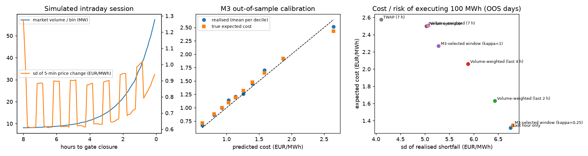

# power-intraday-alpha — Module 1: market impact & execution on continuous intraday power

Calibrating a market impact model for the continuous intraday power market, then using it to
schedule the execution of a position before gate closure.

> **All results below come from a simulator** (`src/power_intraday_alpha/sim.py`). EPEX tick data is paid. The
> simulator follows public stylized facts: volume concentrates near gate closure, volatility
> rises towards delivery, and hourly renewable-forecast updates cause jumps. Its true impact
> model is a propagator with power-law instantaneous impact. The numbers show that the
> methodology works when the truth is known. They are **not** an empirical validation on real
> market data.

## Run

Requires [uv](https://docs.astral.sh/uv/).

```bash
uv sync                      # creates .venv from uv.lock
uv run power-intraday-alpha  # ~15 s, writes results/metrics.json and results/summary.png
uv run pytest                # unit tests
```

Code: `src/power_intraday_alpha/` — `sim.py` (simulator), `impact.py` (metaorders, ex-ante
features, models M0–M3), `execution.py` (schedules), `experiments.py` (everything above).

## Setup

- **Sessions:** 250 days × 24 hourly products, each simulated over the last 8 h before gate
  closure in 5-min bins. Market volume grows 40% over the period.
- **Metaorders:** 24,000 TWAP orders lasting 30 min to 3 h, at 2–30% participation. For each
  one we record the realised implementation shortfall and the expected cost, i.e. the same
  execution with the price path frozen (an oracle only available in simulation).
- **No look-ahead:** liquidity and volatility forecasts combine seasonal profiles (hour of
  delivery × time to gate closure, estimated on training days only) with the day's activity
  observed over the hour before the order.
- **Validation:** walk-forward with an expanding window. The first test day is day 100, and
  the models are re-calibrated every 25 days.

## Results (simulation)

**1. Impact calibration, out of sample** (days 100–249)

| Model | MAE vs expected cost (EUR/MWh) |
|---|---|
| M0 constant cost | 0.44 |
| M1 linear in size (Almgren–Chriss, constant liquidity) | 0.35 |
| M2 square-root law, constant liquidity | 0.34 |
| **M3 participation-rate law conditioned on time to delivery & daily activity** | **0.20** |

Conditioning on liquidity cuts the out-of-sample error on expected cost by **40%** versus the
constant-liquidity square-root law.

**Parameter recovery.** Fitted on the noise-free cost, the impact exponent comes out at δ =
0.55 (± 0.01), against a true value of 0.5. Fitted on noisy realised costs with estimated
volatility, it rises to 0.70 (± 0.05), an errors-in-variables bias to keep in mind on real data.

**2. Execution of a 100 MWh buy** (100 out-of-sample days × 24 products, decision 7 h before
gate closure)

| Schedule | Expected cost | Shortfall sd |
|---|---|---|
| TWAP over 7 h | 2.58 | 4.10 |
| M3-selected window (κ = 1) | 2.27 (−12%) | 5.28 |
| Volume-weighted, last 2 h | 1.63 (−37%) | 6.43 |
| Last hour only | 1.32 (−49%) | 6.75 |

All values are in EUR/MWh. Waiting for gate-closure liquidity **halves the expected cost**
compared with TWAP, but raises the volatility of the shortfall by **65%**: the classic cost/risk
frontier, which the M3-based window selection lets you move along. A per-bin optimiser that
ignores the build-up of transient impact gains only 3% over TWAP: getting the model's duration
term right matters more than the optimiser itself. Differences against TWAP have 95% confidence
intervals that exclude zero (bootstrap by day, see `results/metrics.json`).



## Limits / next steps

- Every conclusion depends on the simulator. The next step is to recalibrate its volume and
  volatility profiles on public aggregated EPEX statistics, then on tick data if available.
- Not modelled yet: 15-min products, cross-border vs local gate closure, and the interaction
  between metaorders.
- The impact model is calibrated at the metaorder level. A child-order-level propagator
  calibration would let the optimiser account for impact decay directly.
